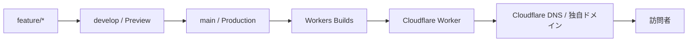

# ポートフォリオの構成方針

個人ポートフォリオを、軽量で更新しやすい静的サイトとして、独自ドメインで公開する

Next.jsの静的出力を、Cloudflare Workerから配信する

このページの読み手は、サイトの構成や公開手順を確認する開発者とAIエージェントを想定している

最初のリリース（MVP）で提供するのは、作品紹介、プロフィール、外部SNSへの導線である

## 現在の構成

| 領域 | 現行の構成 | 次の候補 |
| --- | --- | --- |
| フロントエンド | Next.js / React / TypeScript、静的出力（トップページはキャンバス型） | 詳細ページを段階的に追加 |
| コンテンツ | 作品は `content/projects/*.md` | 詳細本文の拡充 |
| 画像・動画 | `public/` で管理 | 増えたらCloudflare R2を検討 |
| ホスティング | Cloudflare Workers Buildsが、静的出力をWorkerへ配信 | SSRが必要になったら再評価 |
| ドメイン・DNS | Cloudflare Registrar / DNS | 継続 |
| アクセス解析 | Cloudflare Web Analytics（Cookieバナーなしで閲覧状況を確認） | 継続 |
| ソース管理 | GitHub | 継続 |
| 管理画面・認証 | なし | 要件が明確になったら検討 |

次の方針で運用する

- 画像とfaviconの正本は `public/` に置く
- DBと管理画面は、まだ導入しない
  - ブラウザからの編集、画像のアップロード、即時公開の需要が明確になった時点で判断する
- トップページの設計は、[キャンバス型ポートフォリオの設計](infinite-canvas.md)にまとめている
  - 作品情報は `content/projects/*.md` に書き、ビルド時に静的HTMLへ取り込む
- 旧版へ戻すときは、Gitの履歴か、Cloudflareの過去のdeploymentを使う

## 公開の流れ

作業ブランチから訪問者に届くまでの流れは、次のとおり



### ブランチの設定（初回のみ）

1. `main` を本番ブランチ、`develop` を統合・検証用ブランチにする
2. GitHubのデフォルトブランチと、通常のPull Requestのbaseを `develop` にする
3. `main` と `develop` への直接pushを禁止し、Branch protectionを設定する

ブランチ制御とPull Requestの必須チェックは、[ADR 0004](adr/0004-branching-and-deployment-strategy.md)を参照する

### 日常の公開手順

1. `develop` から `feature/*`、`fix/*`、`docs/*` などの作業ブランチを作る
2. 変更をcommitして、GitHubへpushする
3. 作業ブランチから `develop` へPull Requestを作る
   - Workers BuildsのPreview URLと、GitHub Actionsの `quality-gate` を確認する
4. Preview URLで、表示、リンク、スマートフォン幅のレイアウトを確認する
5. `develop` へマージして、統合した状態を確認する
6. リリースするときは、`develop` から `main` へPull Requestを作る
7. `main` へマージすると、Workers Buildsが本番デプロイを始める
8. Cloudflareの **Workers & Pages** で、buildが成功したことを確認する
9. 現在の本番URLで、リンクとモバイル表示を確認する

デプロイに失敗したときは、Workers Buildsのbuild logを確認する

Build command、Deploy command、Preview commandは、Cloudflare上のWorker設定を正とする

## Cloudflareの設定

Workerの名前は `my-portfolio` である

GitHubの本番コミットには、Workers Buildsの成功チェックが付く

### Workers Buildsのブランチ制御

1. Cloudflareダッシュボードで、**Workers & Pages** → **my-portfolio** → **Settings** → **Build** → **Branch control** を開く
2. Production branchを、`main` に明示して設定する
   - GitHubのデフォルトブランチを `develop` に変えても、Production branchは変わらないことを確認する
3. Preview buildsを有効にし、`develop` と作業ブランチからPreviewを作れるようにする
4. 既存のBuild command、Deploy command、Preview commandを記録する
   - Previewが本番のdeploymentを置き換えないことを確認する
5. Worker Custom DomainとDNSレコードは、変更しない

Workers Buildsは、production branchへのpushで本番をbuildする

Preview buildsを有効にすると、ほかのブランチはPreviewとして扱われる

### ドメイン

- `example.com` を正規URLにする
- `www.example.com` は `example.com` へリダイレクトする
- 公開ホスト名は、Cloudflare DNSとWorkerのCustom Domainで管理する
- HTTPSをCloudflareで有効にし、常にHTTPSで配信する

実際のドメイン名が決まるまで、設定値やURLをリポジトリに固定で書かない

### Web Analytics

Cloudflare Web Analyticsは、Workersのデプロイ方式とは別に管理する

既存の設定を維持し、ホスティングを変えたときは、計測が続いていることを確認する

### 公開後の確認コマンド

`example.com` を実際のドメインに置き換えて、手元の端末から実行する

```sh
curl --head --location https://example.com/
curl --head --location https://www.example.com/
```

確認する項目は、次の3つ

- どちらも最終的に `https://example.com/` を返す
- `www` からの最初の応答が `301` である
- HTTPSのエラーがない

## 運用上の注意

- APIキー、トークン、個人情報をリポジトリにcommitしない
  - ビルド変数とsecretは、Workers Buildsの設定で管理する
- `main` 以外へのpushもPreview buildの対象になり得る
  - Preview用のsecretとbindingは、productionと分けて設定する
- 大きな画像や動画を追加する前に、ローカルと、モバイル回線相当の速度で、読み込みを確認する

## アセットの方針

- MVPの画像と短い動画は、リポジトリ内で管理する
- 画像は、可能ならWebPまたはAVIFに変換し、表示サイズに合わせて圧縮する
- ヒーロー動画は、モバイル回線を考えて短く軽くする
  - 動画がなくても成立するように、背景色または静止画を用意する
- 他者の写真、動画、SNS投稿は、無断で転載も直リンクもしない
  - 自作物、利用許諾済みの素材、ライセンス条件を満たす素材だけを使う

## MVPに含めないもの

次の機能は、必要になった時点で追加を検討する

- お問い合わせフォーム
- サーバー側のAPIと動的な処理
- Turnstile
- データベース
- 会員機能と管理画面
- R2による画像・動画の配信

### 将来の拡張

**お問い合わせフォーム**：ブラウザからメール送信サービスへ直接つながない

Cloudflare Workersに `/api/contact` を実装し、Turnstileをサーバー側で検証してから、メール送信サービスへ渡す

APIキーは、Cloudflareのsecretで管理する

**R2**：作品の画像や動画が増えて、リポジトリでの管理が重くなったら導入する

公開先は `assets.example.com` のような独自サブドメインにする

開発用の `r2.dev` のURLは、本番の配信に使わない

## 公開前チェック

- [ ] 独自ドメインと `www` のリダイレクトが、意図どおりに動く
- [ ] HTTPSで表示され、HTTPからHTTPSへ転送される
- [ ] PCとスマートフォンで、主要な画面を確認した
- [ ] 作品リンク、SNSリンク、OGP画像を確認した
- [ ] 画像と動画の利用権と、クレジット表記を確認した
- [ ] 主要ページのタイトルとdescriptionを設定した

## 情報の確認元

Cloudflareの設定項目は変わることがある

実施するときに、公式ドキュメントも確認する

- [Cloudflare Workers Builds](https://developers.cloudflare.com/workers/ci-cd/builds/)
- [Cloudflare Workers Builds：Build branches](https://developers.cloudflare.com/workers/ci-cd/builds/build-branches/)
- [Cloudflare Workers Builds：Configuration](https://developers.cloudflare.com/workers/ci-cd/builds/configuration/)
- [Cloudflare Workers：Custom Domains](https://developers.cloudflare.com/workers/configuration/routing/custom-domains/)
- [Cloudflare Web Analytics：Get started](https://developers.cloudflare.com/web-analytics/get-started/)
