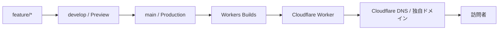

# ポートフォリオの構成方針

## 目的

個人ポートフォリオを、軽量で更新しやすく、独自ドメインで公開する。
MVPでは作品紹介・プロフィール・外部SNSへの導線を提供する。

## 新しいトップページの方針（2026-10-23）

トップページはLayers / Canvas / Inspectの3ペインを持つ探索型ポートフォリオへ段階的に改修する。操作とコンテンツの詳細は[Infinite canvas portfolio](infinite-canvas.md)を参照。既存ページは移行中 `/classic` に保持する。作品情報の新しい正本は `content/projects/*.md` とし、ビルド時に静的HTMLへ取り込む。

## 現在の構成（2026-10-23）

サイトはNext.js App Router / React / TypeScriptで構成し、静的出力をCloudflare Workerから配信する。移行前のHTML / CSS / JavaScriptは比較用に`legacy/static-site`へ保管し、画像とfaviconは`public`を正本として共有する。旧版への復旧にはGit履歴またはCloudflareの過去のdeploymentを使う。

DBや管理画面はまだ導入しない。キャンバス型トップページの作品情報は`content/projects/*.md`に置く。従来ページの`app/content/projects.ts`は移行期間中に保持する。ブラウザからの編集、画像アップロード、即時公開などの需要が明確になった時点でDB導入を判断する。

詳しい判断は次の文書に記録する。

- [移行計画](migration-plan.md)
- [ADR 0001: Next.js / Reactへ段階的に移行する](adr/0001-nextjs-react-migration.md)
- [ADR 0002: コンテンツ管理とDB導入時期を分ける](adr/0002-content-management-and-database.md)
- [ADR 0003: Cloudflareのドメイン・DNSとアプリ実行基盤を分離する](adr/0003-cloudflare-domain-and-runtime.md)
- [ADR 0004: developを統合ブランチ、mainを本番デプロイブランチとする](adr/0004-branching-and-deployment-strategy.md)

## 現行構成と次の候補

| 領域 | 現行構成 | 次の候補 |
| --- | --- | --- |
| フロントエンド | Next.js / React / TypeScript、静的出力。トップはキャンバス型、従来画面は`/classic` | 詳細ページなどを段階的に追加 |
| コンテンツ | キャンバスの作品は`content/projects/*.md`、従来画面は`app/content/projects.ts` | 詳細本文の拡充と従来データの整理 |
| 画像・動画 | `public/`で管理。旧サイトも同じ画像を参照 | 増加時にCloudflare R2などを検討 |
| ホスティング | Cloudflare Workers BuildsからWorkerへ静的出力を配信 | SSRなどが必要になった時点で方式を再評価 |
| ドメイン・DNS | Cloudflare Registrar / DNS | 継続 |
| 管理画面・認証 | なし | 要件が明確になった時点で検討 |

## MVPの構成



| 領域 | 採用するもの | 役割 |
| --- | --- | --- |
| ドメイン・DNS | Cloudflare Registrar / DNS | ドメインの取得と名前解決 |
| ホスティング | Cloudflare Workers | サイトを実行・配信 |
| デプロイ | Cloudflare Workers Builds | `main`から本番デプロイし、他ブランチはPreviewとして確認 |
| ソース管理 | GitHub | ソースコードと変更履歴の管理 |
| フロントエンド | Next.js / React / TypeScript | 静的出力をCloudflare Workerで配信 |
| アクセス解析 | Cloudflare Web Analytics | Cookieバナーなしで基本的な閲覧状況を確認 |

## ドメイン設計

- `example.com` を正規URLとする。
- `www.example.com` は `example.com` へリダイレクトする。
- 公開ホスト名はCloudflare DNSとWorkerのCustom Domain設定で管理する。
- HTTPSはCloudflareで有効化し、常にHTTPSを利用する。

実際のドメイン名が決まるまでは、設定値やURLをリポジトリに固定で書かない。

## デプロイ運用

1. GitHubの`main`ブランチを本番ブランチにする。
2. GitHubの`develop`ブランチを統合・検証用ブランチにする。
3. GitHubのデフォルトブランチと通常のPull Requestのbaseを`develop`にする。
4. `main`と`develop`への直接pushを禁止し、Branch protectionを設定する。
5. 作業は`develop`から`feature/*`、`fix/*`、`docs/*`などのブランチを作成して行う。
6. 作業ブランチから`develop`へPull Requestを作成し、Preview URLと必須チェックを確認する。
7. リリース時は`develop`から`main`へPull Requestを作成する。
8. `main`へのマージを本番デプロイのトリガーにする。
9. 本番デプロイ後に、本番URL、リンク、モバイル表示を確認する。

Cloudflare Workers Buildsではproduction branchを`main`に設定し、Preview buildsを有効にする。ブランチ制御とPRの必須チェックは[ADR 0004](adr/0004-branching-and-deployment-strategy.md)を参照する。

## Cloudflare Workers Buildsの設定

GitHubの本番コミットにはWorkers Buildsの成功チェックがあり、Worker名は`my-portfolio`である。GitHub側のbranch controlは次のようにする。

1. Cloudflareダッシュボードで **Workers & Pages** → **my-portfolio** → **Settings** → **Build** → **Branch control** を開く。
2. Production branchを`main`に明示設定する。GitHubのデフォルトブランチを`develop`へ変更しても、本番ブランチが連動変更されないよう確認する。
3. Preview buildsを有効にし、`develop`と作業ブランチからPreviewを作成できる状態にする。
4. 既存のBuild command、Deploy command、Preview commandを記録し、Previewが本番deploymentを昇格・置換しないことを確認する。
5. 既存のWorker Custom DomainとDNSレコードはこの作業では変更しない。

CloudflareのWorkers Buildsはproduction branchへのpushでproduction buildを行い、Preview buildsを有効にすると他ブランチをPreviewとして扱う。利用中のPreview commandやPreview設定はWorkerの既存状態を確認して維持する。

### 日常の公開フロー

1. `develop`から作業ブランチを作り、変更をcommitしてGitHubへpushする。
2. 作業ブランチから`develop`へのPull Requestを作成する。Workers BuildsのPreview URLとGitHub Actionsの`quality-gate`を確認する。
3. Preview URLで表示、リンク、スマートフォン幅のレイアウトを確認する。
4. `develop`へマージし、統合状態を確認する。
5. リリース時に`develop`から`main`へのPull Requestを作成する。
6. `main`へマージするとWorkers Buildsが本番デプロイを開始する。
7. Cloudflareの **Workers & Pages** で対象buildが成功したことを確認し、現在の本番URLで公開確認を行う。

失敗時はWorkers Buildsのbuild logを確認する。Build command、Deploy command、Preview commandはCloudflare上のWorker設定を正として確認する。

### 公開後の確認コマンド

実ドメインへ置き換えて、ローカル端末から次を実行する。

```sh
curl --head --location https://example.com/
curl --head --location https://www.example.com/
```

両方が最終的に`https://example.com/`を返すこと、`www`からの最初の応答が`301`であること、HTTPSのエラーがないことを確認する。

### Web Analytics

Cloudflare Web AnalyticsはWorkersのデプロイ方式と独立して管理する。既存のAnalytics設定を維持し、ホスティング変更時に計測が継続していることを確認する。

## 運用上の注意

- APIキー、トークン、個人情報をリポジトリへcommitしない。ビルド変数やsecretはWorkers Buildsの設定で管理する。
- `main`以外へのpushはPreview buildの対象になり得る。Preview用のsecretやbindingはproductionと分けて設定する。
- 大きな画像・動画を追加する前に、ローカル表示とモバイル回線相当での読み込みを確認する。

## 情報の確認元

Cloudflareの設定項目は変わり得るため、実施時にも公式ドキュメントを確認する。

- [Cloudflare Workers Builds](https://developers.cloudflare.com/workers/ci-cd/builds/)
- [Cloudflare Workers Builds: Build branches](https://developers.cloudflare.com/workers/ci-cd/builds/build-branches/)
- [Cloudflare Workers Builds: Configuration](https://developers.cloudflare.com/workers/ci-cd/builds/configuration/)
- [Cloudflare Workers: Custom Domains](https://developers.cloudflare.com/workers/configuration/routing/custom-domains/)
- [Cloudflare Web Analytics: Get started](https://developers.cloudflare.com/web-analytics/get-started/)

## アセット方針

- MVPの画像・短い動画は、リポジトリ内で管理する。
- 画像は可能な限りWebPまたはAVIFに変換し、表示サイズに合わせて圧縮する。
- ヒーロー動画はモバイル回線を考慮して短く・軽くし、動画なしでも成立する背景色または静止画を用意する。
- 他者の写真・動画・SNS投稿を無断で転載・直リンクしない。自作物、利用許諾済み素材、またはライセンス条件を満たす素材を使う。

## MVPの対象外

以下はMVPに含めない。必要性が生じた段階で追加を検討する。

- お問い合わせフォーム
- サーバー側APIや動的処理
- Turnstile
- データベース
- 会員機能・管理画面
- R2による画像・動画配信

## 将来拡張

### お問い合わせフォーム

フォームを追加する場合は、ブラウザからメール送信サービスへ直接接続しない。
`/api/contact`をCloudflare Workersで実装し、Turnstileをサーバー側で検証した後にメール送信サービスへ渡す。
APIキーはCloudflareのシークレットとして管理する。

### R2

作品画像や動画が増え、リポジトリ管理が重くなった場合はCloudflare R2を導入する。
公開先は`assets.example.com`のような独自サブドメインにし、開発用の`r2.dev` URLは本番配信に使わない。

## 公開前チェック

- [ ] 独自ドメインと`www`のリダイレクトが意図どおりである
- [ ] HTTPSで表示され、HTTPからHTTPSへ転送される
- [ ] PC・スマートフォンで主要画面を確認した
- [ ] 作品リンク・SNSリンク・OGP画像を確認した
- [ ] 画像・動画の利用権とクレジット表記を確認した
- [ ] 主要ページのタイトルとdescriptionを設定した
