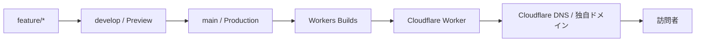

# 公開手順

作業ブランチで変更し、`develop` でPreviewを確認してから、`main` へのマージで本番に公開する。このページは、その手順と、公開前後の確認項目をまとめる。読み手は、サイトを公開する開発者とAIエージェントを想定している。Cloudflare側の設定は[Cloudflareの設定](cloudflare.md)を参照する。

## 公開の流れ

作業ブランチから訪問者に届くまでの流れは、次のとおり。



## ブランチの設定（初回のみ）

1. `main` を本番ブランチ、`develop` を統合・検証用ブランチにする
2. GitHubのデフォルトブランチと、通常のPull Requestのbaseを `develop` にする
3. `main` と `develop` への直接pushを禁止し、Branch protectionを設定する


## 日常の公開手順

1. `develop` から `feature/*`、`fix/*`、`docs/*` などの作業ブランチを作る
2. 変更をcommitして、GitHubへpushする
3. 作業ブランチから `develop` へPull Requestを作る
   - Workers BuildsのPreview URLと、GitHub Actionsの `quality-gate` を確認する
4. Preview URLで、表示、リンク、スマートフォン幅のレイアウトを確認する
5. `develop` へマージして、統合した状態を確認する
6. リリースするときは、`develop` から `main` へPull Requestを作る
7. `main` へマージすると、Workers Buildsが本番デプロイを始める
8. Cloudflareの **Workers & Pages** で、buildが成功したことを確認する
9. 現在の本番URLで、リンクとモバイル表示を確認する

デプロイに失敗したときは、Workers Buildsのbuild logを確認する。Build command、Deploy command、Preview commandは、Cloudflare上のWorker設定を正とする。

## 公開前チェック

- [ ] 独自ドメインと `www` のリダイレクトが、意図どおりに動く
- [ ] HTTPSで表示され、HTTPからHTTPSへ転送される
- [ ] PCとスマートフォンで、主要な画面を確認した
- [ ] 作品リンク、SNSリンク、OGP画像を確認した
- [ ] 画像と動画の利用権と、クレジット表記を確認した
- [ ] 主要ページのタイトルとdescriptionを設定した

## 公開後の確認コマンド

`example.com` を実際のドメインに置き換えて、手元の端末から実行する。

```sh
curl --head --location https://example.com/
curl --head --location https://www.example.com/
```

確認する項目は、次の3つ。

- どちらも最終的に `https://example.com/` を返す
- `www` からの最初の応答が `301` である
- HTTPSのエラーがない

## 運用上の注意

- APIキー、トークン、個人情報をリポジトリにcommitしない
  - ビルド変数とsecretは、Workers Buildsの設定で管理する
- `main` 以外へのpushもPreview buildの対象になり得る
  - Preview用のsecretとbindingは、productionと分けて設定する
- 大きな画像や動画を追加する前に、ローカルと、モバイル回線相当の速度で、読み込みを確認する
