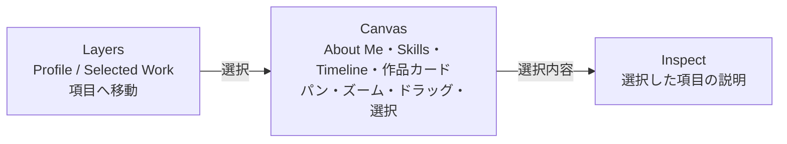

# Infinite canvas portfolio

## 目的と体験

トップページを、作品やプロフィールを自由な位置に置いた探索型ポートフォリオにする。編集ツール風の枠組みを使うが、訪問者が内容を理解することを優先する。最初に名前・役割・主要作品が見え、詳細を読まずに概要をつかめる。

- 中央Canvasは常に最も広い領域にする。左右のペインは補助として幅を抑える。
- デスクトップではペイン境界をドラッグ、またはフォーカス後に左右矢印キーで動かせる。Canvasの最小幅を保ち、モバイルでは縦並びのままにする。
- LayersではAbout Me・Skills・TimelineをProfile、4作品をSelected Workにまとめる。Canvas上では固定の枠で囲まず、カードを自由に移動できる。初期配置は毎回同じにする。
- About Meを大きな中央カードに置き、作品4件を異なる距離と高さに散らす。SkillsとTimelineは周囲に配置する。カードは傾けない。最初の画面で周囲の作品が少し見えるようにし、訪問者がドラッグした位置はその閲覧中のみ保持する。
- 背景ドラッグでパン、ホイール・操作ボタンでズーム、カードのヘッダーで移動、右下のつまみでサイズ変更、クリックまたはLayersから選択する。ズームはポインター位置を基準にする。カードの位置とサイズはその閲覧中のみ保持する。
- タッチ操作では2本指でキャンバスを拡大縮小できる。ピンチの中心を基準にし、同時にカードが移動しないようにする。狭い画面ではズームボタンも指で押しやすい大きさにする。
- カードをクリックするたびにそのカードを最前面へ出す。Layersからの選択やカードの移動・サイズ変更でも同じ順序にする。
- 作品カードには「何のアプリか」を短く書き、Inspectには利用者ができることや使う場面を説明する。使用技術はカードとInspectに補助情報として残し、担当・こだわり・実装の詳細は将来の詳しい紹介に分ける。
- Skillsカードは技術の分類とアイコン付きの技術名をコンパクトに表示し、サイズ変更は行わない。Timelineカードは活動名と時期を表示する。選択するとInspectで各項目を読める。
- 狭い画面ではサイドペインを縦に並べ、Canvasを先に探索できる構成にする。
- キーボードでもLayersから選択・移動でき、Canvasの矢印キーとズームボタンで移動できる。カード右下のつまみは矢印キーでもサイズ変更できる。動きの軽減設定を尊重する。
- カードの移動・サイズ変更は「取り消し」または⌘Z / Ctrl+Zで一操作ずつ戻せる。履歴は閲覧中のみ保持し、繰り返すと初期の配置・大きさに戻る。

## コンテンツ

- 作品の正本は `content/projects/*.md`。Frontmatterに `slug`, `title`, `description`（カード用のひと言）, `overview`（Inspect用の説明）, `technologies`, `image`, `imageAlt`, `href`, `x`, `y` を持たせる。
- SkillsとTimelineの正本は `content/skills.md` と `content/timeline.md`。Frontmatterの `title`, `summary`, `x`, `y` と、本文の `##` 見出しで内容を管理する。Timelineは従来ページのActivity、Skillsは従来ページのSkillsを元にした。
- 本文は将来の詳しい紹介用に保存し、Inspectには表示しない。Frontmatterは単純な `key: value` の行形式で、複雑なYAML構文は使わない。
- リポジトリ内のMarkdownをビルド時に読む。DB・管理画面・サーバーAPIは追加しない。静的出力と既存のCloudflare配信方式を維持する。

## 段階

1. 現状調査と方針記録、既存ページの退避先確保。
2. Layers / Canvas / Inspectと基本操作をトップページに実装。既存4作品をMarkdownへ移す。
3. PC・スマートフォン・キーボードで操作と読みやすさを確認して調整。
4. 必要になった作品だけ本文や詳細ページを充実させる。

公開環境のPreview・本番での確認はローカル確認と区別して記録する。
