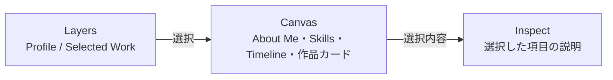

# キャンバス型ポートフォリオの設計

トップページは、作品とプロフィールのカードを、広いキャンバスに並べた探索型にする

訪問者が内容を理解できることを、編集ツール風の見た目より優先する

このページの読み手は、トップページを変更する開発者とAIエージェントを想定している

## 体験の方針

- 最初の画面で、名前、役割、主要作品が見える
  - 詳細を読まなくても概要をつかめる
- 初期配置は毎回同じにする
  - 訪問者が動かした位置とサイズは、その閲覧中だけ保持する
- 中央のキャンバスを、常に最も広い領域にする

## 画面の構成

画面は次の3つのペインで構成する

| ペイン | 役割 |
| --- | --- |
| Layers | 項目の一覧（選択すると、キャンバスがその項目へ移動する） |
| Canvas | カードを置く広い領域（パン、ズーム、カードの移動で探索する） |
| Inspect | 選択した項目の説明 |

### Layers

- 項目は2つのグループに分ける
  - Profile：About Me、Skills、Timeline
  - Selected Work：作品4件
- キャンバス上では、グループを枠で囲まない

### Canvas

- About Meを大きな中央カードにする
- 作品4件は、距離と高さを変えて散らす
  - 最初の画面で、周囲の作品が少し見えるようにする
- SkillsとTimelineは、周囲に置く
- カードは傾けない

### Inspect

- 作品を選んだとき
  - カードには、「何のアプリか」を短く書く
  - Inspectには、利用者ができることと使う場面を書く
  - 使用技術は、補助情報としてカードとInspectの両方に残す
  - 担当、こだわり、実装の詳細は、将来の詳しい紹介に分ける
- SkillsまたはTimelineを選んだとき
  - 各項目をInspectで読める

### カードの種類

| カード | 表示内容 | サイズ変更 |
| --- | --- | --- |
| About Me | 名前、役割、ひとこと | できる |
| 作品 | 画像、概要、使用技術 | できる |
| Skills | 技術の分類と、アイコン付きの技術名 | できない |
| Timeline | 活動名と時期 | できる |

## 操作

| 操作 | マウス・キーボード | タッチ |
| --- | --- | --- |
| キャンバスの移動（パン） | 背景をドラッグ、矢印キー | 背景をドラッグ |
| 拡大縮小 | ホイール、ズームボタン、`+` / `-` キー | 2本指のピンチ |
| カードの移動 | カードのヘッダーをドラッグ | カードのどこでもドラッグ |
| カードのサイズ変更 | 右下のつまみをドラッグ、またはつまみにフォーカスして矢印キー | 右下のつまみをドラッグ |
| 選択 | カードをクリック、Layersから選ぶ | カードをタップ、Layersから選ぶ |
| ペイン幅の変更 | 境界をドラッグ、またはフォーカスして左右の矢印キー | なし |

操作の細かな決まりは次のとおり

- ズームは、マウスのポインターを基準にする
  - ピンチは、2本指の中心を基準にする
- ピンチ中は、カードを動かさない
- カードを選ぶたびに、そのカードを最前面に出す
  - Layersからの選択、カードの移動、サイズ変更でも同じにする
- ペインを広げても、キャンバスの最小幅を保つ

### 狭い画面

- ペインを縦に並べ、キャンバスを先に探索できるようにする
- ペイン幅の変更はできない
- ズームボタンは、指で押しやすい大きさにする

### アクセシビリティ

- キーボードだけで、Layersの選択、キャンバスの移動とズーム、カードのサイズ変更ができる
- 動きの軽減設定を尊重する

### 未実装の仕様

次の仕様は設計済みだが、まだ実装していない

- カードの移動とサイズ変更を、「取り消し」または⌘Z / Ctrl+Zで、一操作ずつ戻す
  - 履歴は閲覧中だけ保持し、繰り返すと初期の配置と大きさに戻る

## コンテンツ

内容はすべて、リポジトリ内のMarkdownに書く

ビルド時に読み込み、静的に出力する

DB、管理画面、サーバーAPIは追加しない

Markdownの先頭にある `key: value` 形式の設定部分を、Frontmatterと呼ぶ

複雑なYAML構文は使わず、1行に1つの値だけを書く

| 内容 | ファイル | Frontmatter | 本文 |
| --- | --- | --- | --- |
| 作品 | `content/projects/*.md` | `slug`, `title`, `description`, `overview`, `technologies`, `image`, `imageAlt`, `href`, `x`, `y` | 将来の詳しい紹介用（Inspectには表示しない） |
| Skills | `content/skills.md` | `title`, `summary`, `x`, `y` | `##` 見出しが技術の分類、その下の1行が技術名 |
| Timeline | `content/timeline.md` | `title`, `summary`, `x`, `y` | `##` 見出しが時期、その下の1行目が活動名、残りが説明 |

作品のFrontmatterのうち、`description` はカード用のひとこと、`overview` はInspect用の説明である

`x` と `y` は、キャンバス上の初期位置を表す

## 実装構成

実装は `app/canvas/` にある

変更理由ごとにCustom Hookを分け、各Hookのファイル冒頭に次の7項目を書いている

- Intent
- Boundary
- State modeling
- Update surface
- Hidden complexity
- Composition
- Test notes

位置や倍率の計算は、`camera.ts` と `cardLayout.ts` の純粋関数に置く

| Hook | 役割 |
| --- | --- |
| `useCamera` | カメラの状態を持つ（倍率は、常に許容範囲へ丸めて保存する） |
| `usePinchZoom` | 2本指のズーム |
| `useCardLayout` | カードの位置とサイズを持つ（サイズは、範囲内に丸めてから保存する） |
| `useCardSelection` | 選択と最前面の順序（`useReducer`） |
| `useCardGestures` | パン、カードの移動、カードのサイズ変更（同時に有効なジェスチャーは1つ） |
| `usePaneResize` | LayersとInspectの幅 |

## 進め方

1. 現状を調べ、方針を記録する（完了）
2. Layers / Canvas / Inspectと基本操作を実装し、既存4作品をMarkdownへ移す（完了）
3. PC、スマートフォン、キーボードで、操作と読みやすさを確認して調整する
4. 必要な作品だけ、本文や詳細ページを充実させる

公開環境（PreviewとProduction）での確認は、ローカルでの確認と分けて記録する
