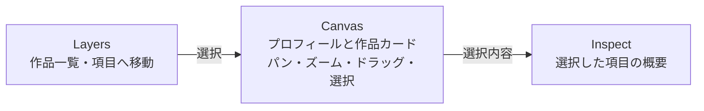

# Infinite canvas portfolio

## 目的と体験

トップページを、作品やプロフィールを自由な位置に置いた探索型ポートフォリオにする。編集ツール風の枠組みを使うが、訪問者が内容を理解することを優先する。最初に名前・役割・主要作品が見え、詳細を読まずに概要をつかめる。

- 中央Canvasは常に最も広い領域にする。左右のペインは補助として幅を抑える。
- カードは固定グリッドに並べず、重ならない初期座標に散らす。訪問者がドラッグした位置はその閲覧中のみ保持する。
- 背景ドラッグでパン、ホイール・操作ボタンでズーム、カードのヘッダーで移動、クリックまたはLayersから選択する。ズームはポインター位置を基準にする。
- Inspectの見出し・説明・リンクはシンプルにする。作品の技術詳細や複雑な独自インタラクションは今後の段階で検討する。
- 狭い画面ではサイドペインを縦に並べ、Canvasを先に探索できる構成にする。
- キーボードでもLayersから選択・移動でき、Canvasの矢印キーとズームボタンで移動できる。動きの軽減設定を尊重する。

## コンテンツ

- 作品の正本は `content/projects/*.md`。Frontmatterに `slug`, `title`, `description`, `technologies`, `image`, `imageAlt`, `href`, `x`, `y` を持たせる。
- 本文は将来のケーススタディ用に保存し、現段階ではInspectに最初の段落だけを表示する。Frontmatterは単純な `key: value` の行形式で、複雑なYAML構文は使わない。
- リポジトリ内のMarkdownをビルド時に読む。DB・管理画面・サーバーAPIは追加しない。静的出力と既存のCloudflare配信方式を維持する。
- 旧 `app/content/projects.ts` は `/classic` の表示用として残す。旧ページの削除は別の判断とする。

## 段階

1. 現状調査と方針記録、既存ページの退避先確保。
2. Layers / Canvas / Inspectと基本操作をトップページに実装。既存4作品をMarkdownへ移す。
3. PC・スマートフォン・キーボードで操作と読みやすさを確認して調整。
4. 必要になった作品だけ本文や詳細ページを充実させる。

公開環境のPreview・本番での確認はローカル確認と区別して記録する。
